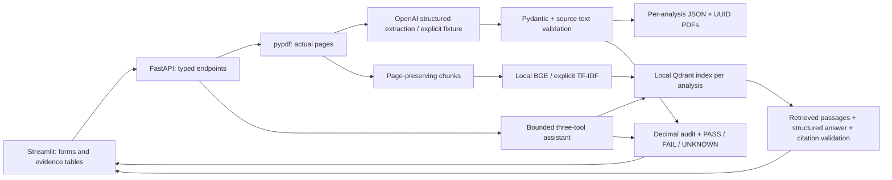

# VendorWise
**AI Quotation Auditor and Comparison Assistant**

A local portfolio project for a buyer comparing up to three laptop quotations. It extracts inspectable evidence, audits arithmetic, checks mandatory requirements, retrieves document passages for questions, and shows what changes when the buyer changes requirements.

**Want a public demo?** Follow [Docker + Render instructions in Hinglish](docs/DEPLOY_HINGLISH.md). The Docker configuration exposes only a clearly labelled synthetic sample demo; it does not expose paid live-model access or personal quotation uploads. Docker/cloud deployment itself is not yet verified.

This is a learning project, not a production purchasing system. Synthetic samples are labelled throughout. Inspect the evidence before relying on a model interpretation.

## Quick start (Windows PowerShell)

Open a terminal in this folder. Python 3.14 was used for the recorded checks; the source declares Python 3.11–3.14 but other Python versions/platforms have not been tested here.

```powershell
python -m venv .venv
.\.venv\Scripts\python -m pip install -r requirements-lock.txt
Copy-Item .env.example .env
.\.venv\Scripts\python -m scripts.generate_samples
```

The supplied PDFs are already generated. Regeneration also refreshes their exact-hash fixture manifest. Do not regenerate just one PDF without refreshing the manifest.

Start the backend in terminal 1:

```powershell
.\start_backend.ps1 -Mode fixture -Embeddings tfidf
```

Start the frontend in terminal 2:

```powershell
.\start_frontend.ps1
```

Open [VendorWise](http://127.0.0.1:8501). Select **Use the three synthetic demo PDFs**, then **Create analysis and extract**. Swagger API documentation is at [localhost:8000/docs](http://127.0.0.1:8000/docs).

If local PowerShell policy prevents scripts, run these commands directly in separate terminals (no activation or execution-policy change required):

```powershell
$env:VENDORWISE_MODE = 'fixture'
$env:EMBEDDING_BACKEND = 'tfidf'
.\.venv\Scripts\python -m uvicorn vendorwise.api:app --host 127.0.0.1 --port 8000
```

```powershell
.\.venv\Scripts\python -m streamlit run streamlit_app.py --server.address 127.0.0.1 --server.port 8501
```

## Real API mode and local semantic embeddings

**OpenRouter:** follow [OpenRouter setup](docs/OPENROUTER_SETUP.md). The example environment selects `openrouter/free`; configure `OPENROUTER_API_KEY` locally and switch to live mode. This uses Chat Completions with required parameter support. The sample live workflow has passed; public deployment remains pending.

**Latest verification:** the live synthetic sample workflow has now passed extraction, comparison, delivery what-if, a manually reviewed cited Q&A answer, and report download. See [validation evidence](docs/VALIDATION.md). Docker image execution and public deployment remain pending; the supplied GitHub Actions workflow will check the Linux image after upload.

**Free-tier Gemini setup:** follow [the beginner guide](docs/FREE_API_HINGLISH.md). Gemini uses Google's Chat Completions-compatible endpoint; OpenAI uses the Responses API. Both paths validate extracted fields and use the same server-owned calculation and search tools. No live provider call has been verified yet.

Edit `.env` on your computer; never paste keys into chat or commit them:

```dotenv
VENDORWISE_MODE=live
LLM_PROVIDER=gemini
GEMINI_API_KEY=your-key-here
GEMINI_MODEL=gemini-3.5-flash-lite
VENDORWISE_PUBLIC_DEMO=false
EMBEDDING_BACKEND=fastembed
EMBEDDING_MODEL=BAAI/bge-small-en-v1.5
```

Then start `start_backend.ps1 -Mode live -Embeddings fastembed` and create a **new** analysis. Existing shell environment variables take precedence over `.env`. The startup script explicitly sets mode and embeddings from its arguments. To use OpenAI instead, set `LLM_PROVIDER=openai`, `OPENAI_API_KEY`, and `OPENAI_MODEL` (example: `gpt-4.1-mini`). Only that provider's key/model settings are used. The example models are not a claim of live verification.

Live extraction and answers send quotation text/retrieved passages to the selected provider. Gemini's selected model has a limited free tier; check your account quota and use nonconfidential samples because Google lists free-tier content as used to improve its products ([pricing](https://ai.google.dev/gemini-api/docs/pricing#gemini-3.5-flash-lite)). Paid API access may incur charges. No API key is required for fixture mode. The first `fastembed` extraction downloads BGE model files into `data/model_cache`; subsequent runs use the cache. Embeddings and Qdrant searches execute locally. A failed model download reports an error; it does not silently substitute another embedding method.

| Mode | Extraction / assistant | Retrieval |
|---|---|---|
| `fixture` + `tfidf` | Exact-hash sample facts; deterministic demo router and source excerpts | Real local TF-IDF lexical vectors in Qdrant; no model download |
| `fixture` + `fastembed` | Same explicit fixture behavior | Real local semantic BGE embeddings in Qdrant |
| `live` + `fastembed` | Gemini or OpenAI structured extraction and bounded function calling | Local semantic retrieval, followed by grounded answer generation |

TF-IDF is a transparent lexical baseline, not a neural semantic model. Fixture responses do not measure live LLM quality and are not presented as AI-generated answers. Arbitrary uploaded PDFs are rejected by fixture extraction even if renamed to a sample filename.

## Demonstration

All samples contain one fictional laptop configuration: 16 GB RAM, 512 GB SSD, 20 laptops (except the quantity-mismatch case), INR only.

| Offer | Unit price | Merchandise | Tax (18% of merchandise) | Shipping | Total | Warranty | Delivery |
|---|---:|---:|---:|---:|---:|---:|---:|
| Vendor A | 45,000 | 900,000 | 162,000 | 18,000 | 1,080,000 | 12 months | 7 calendar days |
| Vendor B | 49,000 | 980,000 | 176,400 | 3,600 | 1,160,000 | 36 months | 12 calendar days |
| Vendor C | 50,000 | 1,000,000 | 180,000 | 10,000 | 1,190,000 | 36 months | 8 calendar days |

Zero discounts and other charges, separate tax/shipping, their bases and no additional charges are explicitly stated. These are synthetic arithmetic examples, not tax guidance.

At INR 1,200,000 budget, 36-month warranty and 10-day delivery, C qualifies; A fails warranty and B fails delivery. Change delivery to 14 days: B becomes the cheapest qualifying offer, INR 30,000 below C. No quantities or quote prices are changed.

The six separate edge-case PDFs cover an incorrect stated total, missing warranty, ambiguous tax inclusion, missing battery coverage, no qualifying vendor and quantity mismatch.

## Architecture and data flow



The UI only calls HTTP endpoints; it does not contain audit or recommendation logic. `vendorwise/logic.py` is pure Python and has no provider dependency. What-if requests reuse stored validated quotations and save only the user's explicitly changed requirements. An exact cost tie returns every tied vendor.

### Where RAG is used

Document questions retrieve up to six page-preserving chunks from the **current analysis**. Chunks are 800 characters with 120-character overlap; a chunk never crosses a PDF page. Qdrant stores their local vectors and metadata. Retrieval applies explicit document filters, recognizes complete vendor names, and balances results across selected vendors. The live answer is generated from retrieved tool evidence, not by resending every whole document as a question prompt. Initial structured extraction does use the complete page text; that step is **not RAG**.

The server resolves valid citation IDs to exact stored passages, filenames and actual PDF pages. It rejects invented IDs. A mechanical match does not establish semantic entailment or guarantee that a model noticed every clause. Unanswerable questions should say the available documents do not establish the answer, not claim an unstated exclusion. Conflicting answers need multiple retrieved citations.

### Where tool calling is used

One live assistant chooses among `search_documents`, `calculate_quote_total`, and `compare_vendors`. Pydantic arguments reject extra facts/prices. The current analysis is bound by the server, so the model cannot choose another analysis. Unknown document IDs are rejected. At most four tool executions are allowed, followed by a structured final answer; each provider request has a 45-second timeout and one SDK retry. The UI shows actual tool names/outcomes, never fabricated activity or hidden reasoning.

### Why deterministic arithmetic

An LLM interprets language; Python performs arithmetic and eligibility checks. All money uses `Decimal`; each monetary line is rounded to INR 0.01 using `ROUND_HALF_UP`. The discrepancy is **stated minus calculated**. Absolute discrepancy up to INR 0.01 is tolerated. Tax is never assumed. Missing amounts are not zero. Included charges are not added again. Unsupported/unclear bases prevent a complete calculation.

Budget compliance may use an explicitly **unverified vendor-stated total**; this does not make the price verified/comparable. Only offers with every requirement PASS and a verified total are eligible. The least expensive eligible offer wins. Missing facts or unresolved costs that could affect the winner make the result provisional. No weighted scores are used.

## API

| Method | Path | Purpose |
|---|---|---|
| GET | `/health` | Runtime mode, embeddings and whether a key is configured |
| POST | `/analyses` | Create isolated analysis with six requirements |
| POST | `/analyses/{id}/documents` | Multipart `files`; up to three total |
| POST | `/analyses/{id}/extract` | Validate facts and build the local index; repeat calls reuse results |
| GET | `/analyses/{id}/quotes` | Facts, status and evidence |
| POST | `/analyses/{id}/compare` | Deterministic current comparison |
| POST | `/analyses/{id}/ask` | Question plus optional document UUIDs |
| POST | `/analyses/{id}/what-if` | Budget, warranty and delivery only; updates current requirements |
| GET | `/analyses/{id}/report` | Downloadable Markdown audit and evidence |

Use the Swagger examples or inspect the schemas. Invalid inputs return 422; unknown analyses 404; extraction required/mode mismatch 409; oversized bodies 413; provider-invalid results 502; missing provider/model configuration 503. Files use server-generated UUID storage names. Display names are sanitized. An upload batch is validated before files are written; adding a document invalidates previous extraction/comparison state.

## Tests and evaluation

```powershell
.\.venv\Scripts\python -m pytest -q --junitxml=evaluation/results/pytest.xml
.\.venv\Scripts\python -m evaluation.run --split dev --mode fixture --embeddings tfidf
.\.venv\Scripts\python -m evaluation.run --split heldout --mode fixture --embeddings tfidf
.\.venv\Scripts\python -m scripts.smoke_ui
```

Run semantic retrieval evaluation with `--embeddings fastembed`. A live evaluation is explicitly opt-in and can incur charges:

```powershell
.\.venv\Scripts\python -m evaluation.run --split dev --mode live --embeddings fastembed
```

See [recorded validation](docs/VALIDATION.md) for results actually obtained, [evaluation protocol](evaluation/README.md) for denominators and the held-out policy, and `evaluation/results/` for raw evidence. Tests marked `mocked` exercise provider contracts but do not prove live model quality. The UI smoke uses real local HTTP with a headless Streamlit interaction test; it is not a visual browser test.

Validation: the original 40-test baseline expanded to **64 passing tests** after provider and bounded-repair checks. The original `pip check` and **20/20 development plus 6/6 held-out synthetic cases for each of TF-IDF and local BGE retrieval** passed. AppTest and the running Streamlit agent API passed the core workflow. The OpenRouter sample live workflow and one manually reviewed cited answer subsequently passed on 24 November 2026. General live accuracy remains unmeasured. Direct OpenAI/Gemini calls were not exercised. See the validation report for failures, dates and limits.

## Supported inputs and limitations

- One laptop offer/configuration per PDF, up to three text-based English PDFs, INR only. Maximum 10 MiB/file, 20 pages/file, 30,000 text characters/page and 120,000/document. Empty or unreadable pages are rejected with their page number. Other languages are not evaluated.
- No OCR, scans, encrypted PDFs, multi-currency conversion, baskets of different products, conditional pricing schedules or alternative offers. Complex charge bases remain ambiguous. Normalization uses manufacturer decimal storage units: 1 TB = 1,000 GB; GiB/TiB are not silently conflated.
- Multiple explicit taxes can only be represented as one combined effective tax where the same base/combined rate is clear; otherwise clarification is required. Included tax with a nonzero discount is conservatively unverified. Different vendor rounding rules may produce discrepancies needing clarification.
- Delivery checks use stated calendar-day counts from the vendor's stated event. They do not predict a delivery date, assume business days equal calendar days, or determine whether payment/site conditions have been fulfilled. Warranty exceptions remain visible; a nominal duration PASS does not mean all parts are covered for that duration.
- Vendor-name matching recognizes complete extracted names (and the demo's Vendor A/B/C labels), not an alias resolution service. Small top-k retrieval may miss relevant or conflicting clauses. Citation existence is not proof of answer support; human review remains necessary.
- Session data, PDF text and indexes persist under `data/`. Stop the backend and remove a particular UUID folder to delete an analysis. The model cache can be kept. There is no automatic retention policy or browser-refresh recovery UI; session state persists across interactions within a browser tab.
- One local user and **one Uvicorn worker**. A process lock serializes mutations/assistant work; no cross-process locking, authentication, background queue or public deployment hardening. Session UUIDs are isolation, not authentication. Bind to loopback only.
- PDF instructions are treated as untrusted evidence. Tools cannot send emails, make purchases, access arbitrary paths or accept model-invented prices. Prompt injection remains a model reliability risk, not something a system prompt alone eliminates.

## Learning and presentation materials

- [Architecture walkthrough](docs/ARCHITECTURE.md)
- [90-second demo script](docs/DEMO_SCRIPT.md)
- [Ten interview questions and answers](docs/INTERVIEW_GUIDE.md)
- [Honest resume bullet templates](docs/RESUME_BULLETS.md)
- [Official documentation and installed versions](docs/DEPENDENCIES.md)

Recommended reading order: `schemas.py` → `logic.py` → `pdf.py` → `retrieval.py` → `assistant.py` → `service.py` → `api.py` → `streamlit_app.py`.
