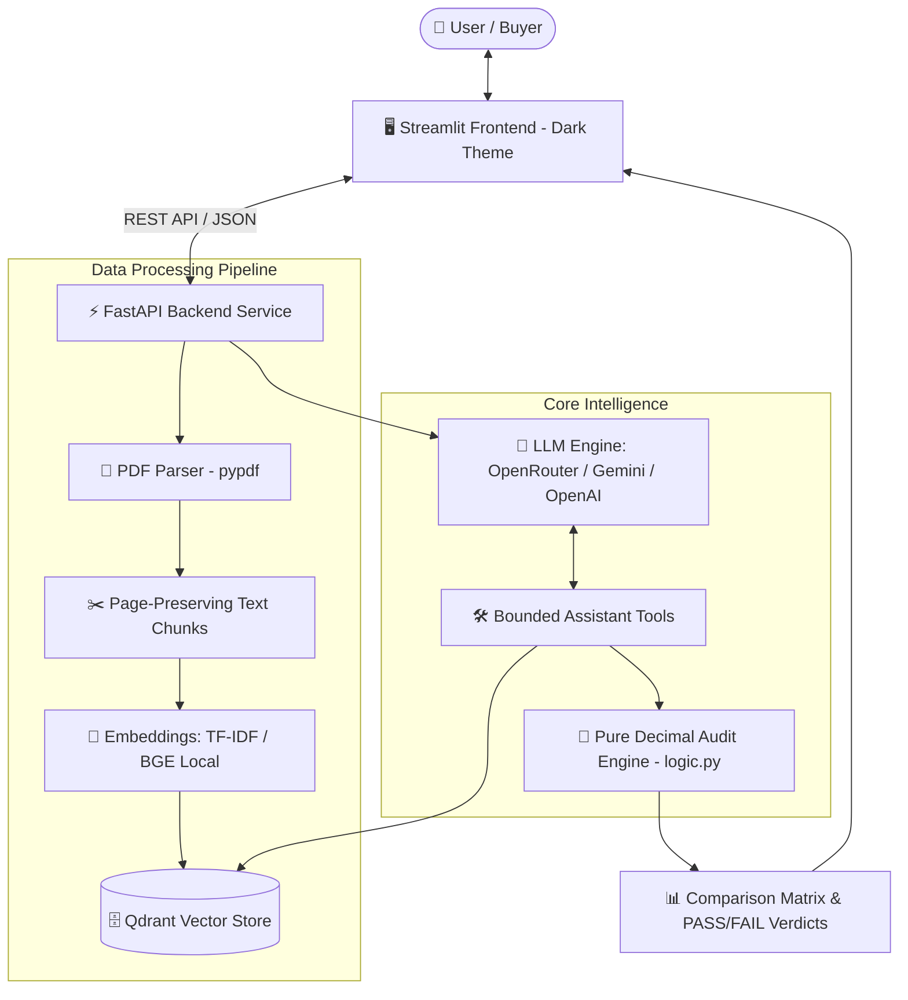

<div align="center">

# 🧾 VendorWise

### **AI-Powered Quotation Auditor & Multi-Vendor Comparison System**

An intelligent, production-ready procurement assistant that audits vendor quotations, verifies commercial arithmetic with zero hallucination, checks RFP specifications, and enables cited document Q&A over quotation PDFs.

[](https://vendorwise.onrender.com)
[](https://github.com/ayushpandey6714-svg/vendorwise)

<br/>

[](https://python.org)
[](https://fastapi.tiangolo.com)
[](https://streamlit.io)
[](https://qdrant.tech)
[](https://docker.com)
[](tests/)

</div>

---

## 🌟 Overview

When procurement teams buy hardware or services, comparing multiple vendor PDF quotes is tedious, error-prone, and slow. Hidden charges, misleading tax structures, mathematical discrepancies, and warranty caveats often slip past human review.

**VendorWise** automates this end-to-end:
1. **Upload up to 5 Quotation PDFs** simultaneously (or test instantly with built-in synthetic quotes).
2. **Deterministic Arithmetic Audit**: Uses Python's exact `Decimal` arithmetic — **no LLM hallucination for prices or totals**.
3. **Requirement Compliance Engine**: Checks strict constraints (Budget, RAM, SSD, Warranty, Delivery) returning structured `PASS`, `FAIL`, or `UNKNOWN` verdicts with exact citations.
4. **Interactive "What-If" Matrix**: Change delivery deadlines or budget sliders to see which vendor becomes the new optimal winner in real time.
5. **RAG-Powered Document Q&A**: Asks questions across all proposals (e.g., *"Is battery replacement covered under warranty?"*) with exact page-level citations.

---

## ⚡ Live Deployment

Experience VendorWise live in your browser:

👉 **[https://vendorwise.onrender.com](https://vendorwise.onrender.com)** 👈

*(Hosted on Render Free Tier with Dark Mode and interactive quote auditing enabled)*

---

## 🎯 Key Features

| Capability | Technical Detail |
|---|---|
| 📑 **Multi-PDF Intake** | Ingests up to 5 vendor PDFs (10 MiB, 20 pages max per document) |
| 🧮 **Zero-Hallucination Math** | Stated totals vs calculated sums verified via Python `Decimal` (`ROUND_HALF_UP` to ₹0.01) |
| 🔍 **Hybrid RAG Retrieval** | Vector search powered by local Qdrant with TF-IDF lexical vectors or BGE semantic embeddings |
| 🤖 **Multi-LLM Support** | Plug-and-play with **OpenRouter**, **Google Gemini**, or **OpenAI** via standard Chat Completions |
| 🛠️ **Bounded Tool-Calling** | Assistant restricted to 3 server-controlled tools (`search_documents`, `calculate_quote_total`, `compare_vendors`) |
| 🌙 **Modern Dark UI** | Responsive Streamlit frontend with glassmorphism touches and intuitive status badges |
| 📊 **Audit Export** | Export a downloadable, audit-ready Markdown report complete with source evidence passages |

---

## 🏛️ System Architecture



---

## 🚀 Quick Start Guide

### Option 1: Local Development (Windows / Linux / macOS)

#### 1. Clone the repository
```bash
git clone https://github.com/ayushpandey6714-svg/vendorwise.git
cd vendorwise
```

#### 2. Create virtual environment & install dependencies
```powershell
python -m venv .venv
.\.venv\Scripts\python -m pip install -r requirements-lock.txt
```

#### 3. Run in Demo Mode (Zero API Keys Required)
**Terminal 1 — Start Backend:**
```powershell
$env:VENDORWISE_MODE = 'fixture'
$env:EMBEDDING_BACKEND = 'tfidf'
.\.venv\Scripts\python -m uvicorn vendorwise.api:app --host 127.0.0.1 --port 8000
```

**Terminal 2 — Start Frontend:**
```powershell
.\.venv\Scripts\python -m streamlit run streamlit_app.py --server.address 127.0.0.1 --server.port 8501
```

Open your browser at **[http://localhost:8501](http://localhost:8501)**.

---

### Option 2: Live AI Mode (Real LLM Extraction & Q&A)

Copy `.env.example` to `.env` and set your preferred provider:

```dotenv
# General Settings
VENDORWISE_MODE=live
VENDORWISE_PUBLIC_DEMO=false
EMBEDDING_BACKEND=tfidf

# Choose Provider: openrouter | gemini | openai
LLM_PROVIDER=openrouter
OPENROUTER_API_KEY=sk-or-v1-your-key-here
OPENROUTER_MODEL=openrouter/free

# Or Google Gemini:
# LLM_PROVIDER=gemini
# GEMINI_API_KEY=your-gemini-key
# GEMINI_MODEL=gemini-2.0-flash-lite
```

Start the application with live settings:
```powershell
.\start_backend.ps1 -Mode live -Embeddings tfidf
.\start_frontend.ps1
```

---

### Option 3: Docker Deployment

Run both backend and frontend isolated in a single Docker container:

```bash
docker compose up --build -d
```
Access the application on **`http://localhost:7860`**.

---

## 📡 API Reference

Interactive Swagger documentation is available locally at `http://127.0.0.1:8000/docs`.

| Method | Endpoint | Purpose |
|---|---|---|
| `GET` | `/health` | Runtime status, provider setup, and embedding mode |
| `POST` | `/analyses` | Initialize a new isolated procurement analysis session |
| `POST` | `/analyses/{id}/documents` | Multipart upload for up to 5 PDF quotes |
| `POST` | `/analyses/{id}/extract` | Structured LLM / fixture quotation extraction |
| `GET` | `/analyses/{id}/quotes` | Retrieve extracted pricing and spec facts |
| `POST` | `/analyses/{id}/compare` | Deterministic compliance check & cost comparison |
| `POST` | `/analyses/{id}/what-if` | Dynamic constraint sensitivity & savings analysis |
| `POST` | `/analyses/{id}/ask` | Grounded question answering with validated citations |
| `GET` | `/analyses/{id}/report` | Generate downloadable Markdown audit report |

---

## 📂 Project Organization

```
vendorwise/
├── streamlit_app.py          # Modern Dark-themed Streamlit UI
├── vendorwise/               # Core application package
│   ├── api.py                # FastAPI HTTP routing & middleware
│   ├── schemas.py            # Pydantic data schemas & contracts
│   ├── logic.py              # Zero-hallucination Decimal math & audit
│   ├── assistant.py          # Bounded AI agent with tool execution
│   ├── retrieval.py          # Chunking, vector indexing & Qdrant RAG
│   ├── pdf.py                # Text extraction from PDF documents
│   ├── provider.py           # Unified client for OpenAI / Gemini / OpenRouter
│   ├── service.py            # Workflow orchestration layer
│   ├── storage.py            # Persistent session & analysis repository
│   ├── config.py             # Strongly-typed environment configuration
│   └── report.py             # Formatted Markdown report builder
├── samples/                  # Pre-generated synthetic PDF quotations (A, B, C)
├── tests/                    # 64 unit and integration test suites
├── evaluation/               # Accuracy benchmarks & held-out datasets
├── scripts/                  # Container supervisors and smoke test scripts
├── Dockerfile                # Production multi-stage container
├── render.yaml               # Cloud deployment blueprint
└── requirements-lock.txt     # Reproducible dependency lockfile
```

---

## 🧪 Testing & Validation

The codebase includes **64 automated tests** verifying financial audit correctness, boundary limits, session isolation, and provider contracts:

```powershell
.\.venv\Scripts\python -m pytest -v
```

---

## 🛡️ Reliability & Security Principles

- **No Float Arithmetic**: All currencies use Python `Decimal` with explicit `ROUND_HALF_UP` to eliminate floating-point drift.
- **Strict Evidence Anchoring**: Quotation facts require supporting page numbers and exact excerpt snippets.
- **Server-Owned Execution**: LLM cannot invent prices or alter calculations; math operations are delegated strictly to deterministic backend routines.
- **Untrusted Input Treatment**: PDFs are treated as untrusted data inputs to prevent prompt injection from affecting comparison criteria.

---

## 👤 Author

**Ayush Pandey**
- GitHub: [@ayushpandey6714-svg](https://github.com/ayushpandey6714-svg)
- Project: [VendorWise](https://github.com/ayushpandey6714-svg/vendorwise)

---

<div align="center">
<sub>Built with precision for transparent, intelligent procurement.</sub>
</div>
